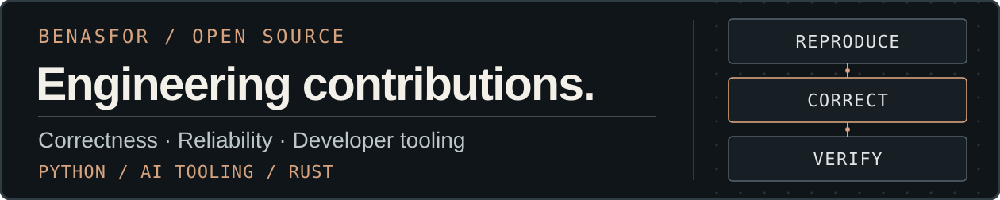

# Open-source contributions

Selected upstream contributions by [@benasfor](https://github.com/benasfor), focused on **software correctness, testing infrastructure, AI agent tooling and Rust-based blockchain infrastructure**.

## Engineering focus

- **Python testing** — Regression coverage and consistent configuration behavior.
- **AI infrastructure** — Agent tooling and precise technical documentation.
- **Software reliability** — Asynchronous behavior, overlapping calls and edge cases.
- **Rust & blockchain** — Serialization, decoding and developer tooling.

## Selected upstream contributions

### Python testing · pytest-timeout

[**PR #227 — Allow zero to disable the session timeout from the command line**](https://github.com/pytest-dev/pytest-timeout/pull/227)

Proposes aligning CLI and configuration behavior, with subprocess regression coverage and documentation.

**Technologies:** Python · pytest  
**Status:** Open — not merged

### Software reliability · pytest-mock

[**PR #664 — Keep spy results consistent across overlapping calls**](https://github.com/pytest-dev/pytest-mock/pull/664)

Proposes resetting recorded spy outcomes at completion for overlapping asynchronous calls and synchronous recursion, with regression tests.

**Technologies:** Python · pytest · asyncio  
**Status:** Open — not merged

### AI agent tooling · Hermes Agent

[**PR #158922 — Distinguish foreground and background shell startup**](https://github.com/NousResearch/hermes-agent/pull/158922)

Proposes correcting terminal troubleshooting guidance for shell initialization, interactive execution and TTY guards. Documentation only.

**Technologies:** Bash · Zsh · Markdown  
**Status:** Open — not merged

### Rust & blockchain infrastructure · Alloy RLP

[**PR #106 — Decode wrappers with named fields**](https://github.com/alloy-rs/rlp/pull/106)

Proposes correcting the RLP decoder derive for single-field named structs, with regression coverage for tuple, named and generic named wrappers.

**Technologies:** Rust · RLP serialization  
**Status:** Open — not merged

## Contribution status

All four listed pull requests were verified as **open and not merged** on **2026-11-25**. Follow the linked upstream pull requests for current review, validation and merge status.

No merged contributions are listed in this selection yet.

---

Focused fixes, reproducible regression cases, and precise documentation.
